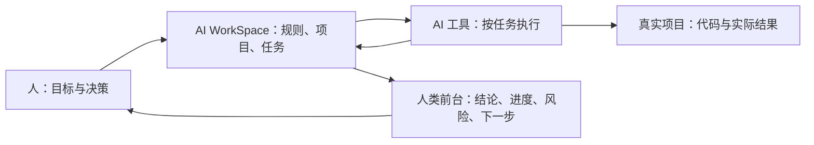

# AI WorkSpace Method

一套用 Markdown 组织多种 AI 工具协作的方法。它把项目事实、任务范围和执行结果放在可检查的文件中，让人能看清 AI 依据什么行动、完成了什么、还缺什么。

> 这是方法和空白模板，不是自动化软件。你可以只用一个 AI 工具，也可以在需要时增加其他工具。

## 核心想法

1. **真实项目是施工现场。** 代码、设计和运行结果留在真实项目中。
2. **AI WorkSpace 是协作后台。** 保存项目目标、已确认决策、当前任务、结果、审查和交接。
3. **人类前台只看关键结果。** 可以用 Obsidian、普通文件夹或其他笔记工具，展示结论、进度、风险和下一步，不复制完整执行日志。
4. **文件是事实来源。** 对版本、路径和状态，以当前可验证的文件与真实环境为准；聊天记录只是线索。
5. **人类保留决定权。** AI 不能凭一条旧消息扩大权限，也不能把任务执行自动等同于发布。



## 最小结构

```text
my-ai-workspace/
├── SYSTEM/
│   └── OPERATING_RULES.md
├── PROJECTS/
│   └── example-project/
│       ├── PROJECT_BRIEF.md
│       ├── PROJECT_BASELINE.md
│       ├── CURRENT_GOAL.md
│       ├── DECISION_LOG.md
│       └── TASKS/
│           └── TASK-001/
│               ├── BRIEF.md
│               ├── RESULT.md
│               ├── REVIEW.md
│               └── HANDOFF.md
└── HUMAN_UPDATES/
    └── example-project.md
```

这只是建议结构；不用先建满所有文件。先让一个真实任务跑通，再增加确实需要的规则。

## 5 分钟上手

1. 在本机创建一个私有的 AI WorkSpace，写下 `SYSTEM/OPERATING_RULES.md`：谁能改什么，什么操作需要确认，怎样记录真实结果。
2. 为一个项目填写 `PROJECT_BRIEF.md`、`PROJECT_BASELINE.md` 和 `CURRENT_GOAL.md`。基线要由项目负责人确认。
3. 用 `TASKS/TASK-001/BRIEF.md` 约定本次目标、修改范围和验收方式；让 AI 只按这份任务执行。
4. 执行后填 `RESULT.md`，必要时由独立审查者填 `REVIEW.md`。跨工具继续时填 `HANDOFF.md`。
5. 把值得人阅读的结论写到 `HUMAN_UPDATES/`，不要同步完整过程。

可直接参考 [`starter/`](starter/README.md) 中的空白模板。结构与信息流见 [`docs/architecture.md`](docs/architecture.md)，具体执行流程见 [`docs/workflow.md`](docs/workflow.md)。

## 记忆如何分层

| 层级 | 保存内容 | 常见文件 |
| --- | --- | --- |
| 全局 | 少量长期有效的协作约束与偏好 | `SYSTEM/OPERATING_RULES.md`、私有的 `USER_MEMORY.md` |
| 项目 | 项目目标、基线、当前目标、已确认决策 | `PROJECT_BRIEF.md`、`PROJECT_BASELINE.md`、`CURRENT_GOAL.md`、`DECISION_LOG.md` |
| 任务 | 一次工作的授权、结果、审查、交接 | `BRIEF.md`、`RESULT.md`、`REVIEW.md`、`HANDOFF.md` |

在冲突时，先看用户当前要求，再核对已确认的项目基线、决策和当前任务。发现重要冲突就停下相关动作，说明冲突，不暗中修改规则。

## 多工具怎么配合

角色按能力和任务划分，不绑定某个产品。一个常见分工是：对话助手整理目标与验收标准；编码工具实现、测试和技术审查；设计工具探索视觉方向；前端工具实现页面。任务文件负责传递上下文，`HANDOFF.md` 负责交接。所有实际修改都要在真实项目里验证。

## 公开仓库与私人工作区

这个仓库只提供方法和空白模板。请把你自己的工作区设为私有，并在分享前检查凭证、个人记忆、客户信息、绝对路径、项目登记、日志与历史提交。`.gitignore` 不能保护已经提交过的内容。更多说明见 [`docs/privacy.md`](docs/privacy.md)。

## 适用范围

适合同时使用多个 AI 工具、需要追踪决策或经常中断后继续的个人项目。小任务可以只写一个简短 `BRIEF` 和 `RESULT`；不用为了流程而制造流程。

## License

MIT，见 [`LICENSE`](LICENSE)。
